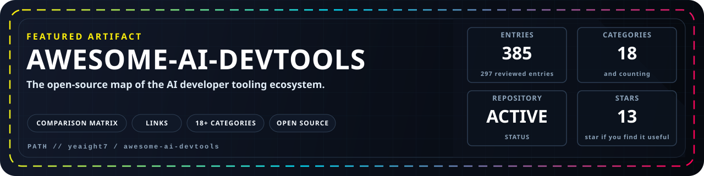
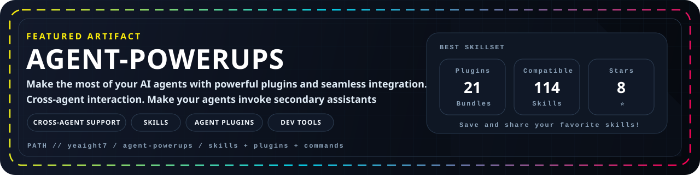
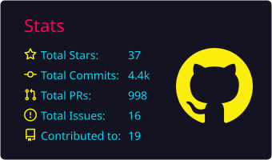
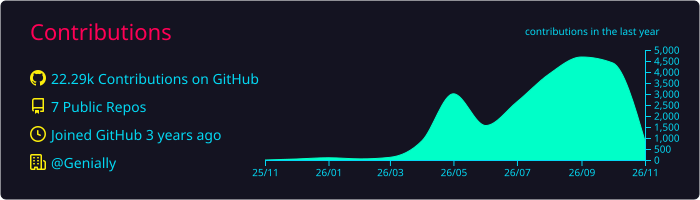
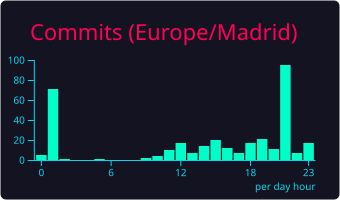

<!-- README_REFRESH: 41510844612-1-21e95db3740f6a063a3889df9a510c8d4776a735 -->

<div align="center">
  
</div>

<div align="center">

### Search. Destroy. Build.

**Data engineering · Applied AI · Cybersecurity**

[Projects](#selected-projects) &nbsp; / &nbsp; [Telemetry](#telemetry) &nbsp; / &nbsp; [Spotify](#spotify-signal) &nbsp; / &nbsp; [LinkedIn](https://www.linkedin.com/in/javier-rivero-iglesias)

</div>

## Mission Control

Hey, I'm **Javier Rivero** (`yeaight7`), a data engineer at [Genially](https://github.com/Genially), with a background in Computer Science and Virtual Technologies and Artificial Intelligence at Loyola University.

I like building things where data, AI and security meet: from tools for coding agents to experiments in reinforcement learning and cyber defense.

```text
  focus  //  data engineering · machine learning · AI tooling · cybersecurity
  mode   //  search, destroy, build
```

## Selected Projects

<a href="https://github.com/yeaight7/awesome-ai-devtools">
  
</a>

**[awesome-ai-devtools](https://github.com/yeaight7/awesome-ai-devtools)** — An open-source map of the AI developer tooling ecosystem, organized with structured metadata and links to original sources. Explore it to discover and compare tools.

<a href="https://github.com/yeaight7/agent-powerups">
  
</a>

**[agent-powerups](https://github.com/yeaight7/agent-powerups)** — Reusable skills, commands, MCP configurations, hooks and workflows for coding agents, with an `apx` CLI to help install them.

### [TFG_CYBER_AI](https://github.com/yeaight7/TFG_CYBER_AI) // Reinforcement learning meets cyber defense

An experimental defender for malicious traffic detection and blocking, built around CICIDS2017, a custom Gymnasium environment and QRDQN training. The repository includes the experiments, validation and report pipeline.

**[Browse all repositories →](https://github.com/yeaight7?tab=repositories)**

## Telemetry

GitHub activity snapshots, generated periodically. The streak card uses the last successful refresh when its data service is unavailable.

<div align="center">
  <table>
    <tr>
      <td></td>
      <td></td>
    </tr>
    <tr>
      <td colspan="2"></td>
    </tr>
  </table>
</div>

<details>
  <summary><b>OPEN // productive-time.log</b></summary>
  <br />
  
</details>

## Spotify Signal

<div align="center">
  <a href="https://spotify-github-profile.kittinanx.com/api/view?uid=elputoamoestabaenuso-4&redirect=true">
    
  </a>
</div>

<div align="center">
  <sub>Keep the signal alive. // <a href="https://github.com/yeaight7">GitHub</a> · <a href="https://www.linkedin.com/in/javier-rivero-iglesias">LinkedIn</a></sub>
</div>
